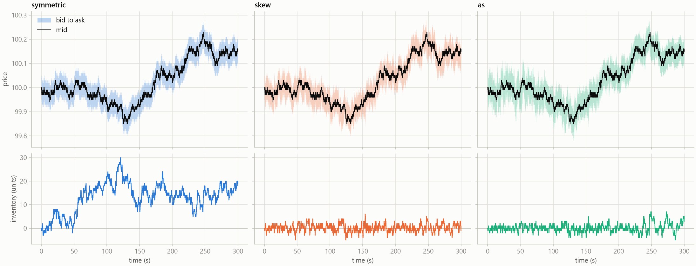
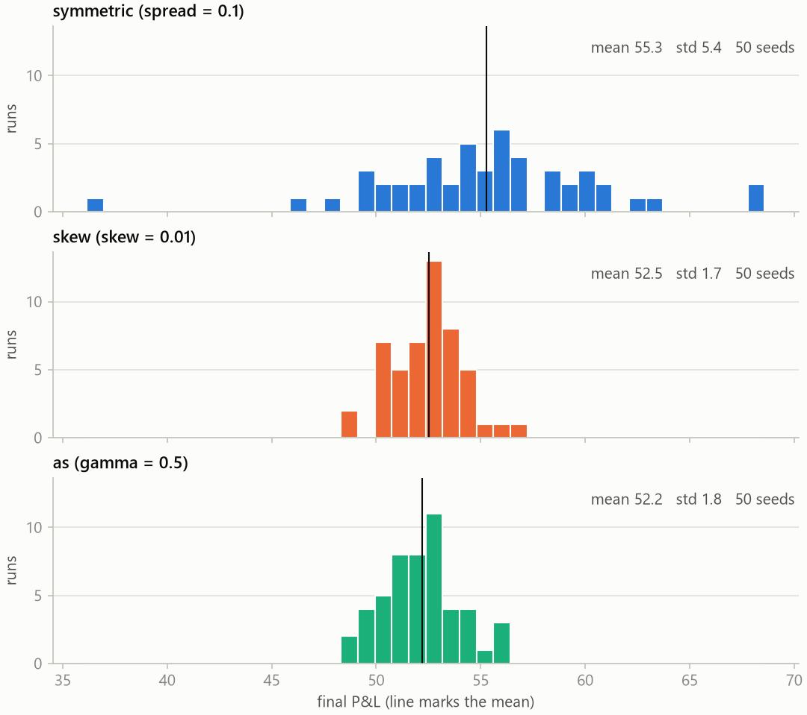
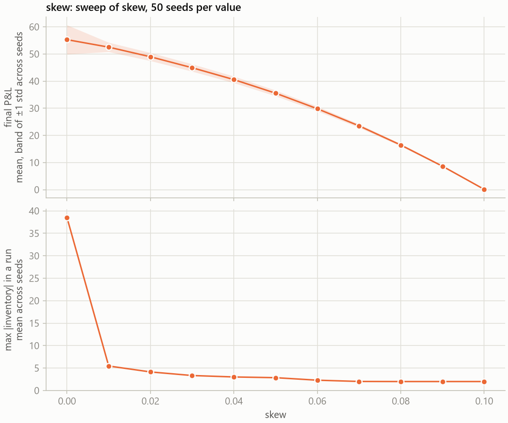
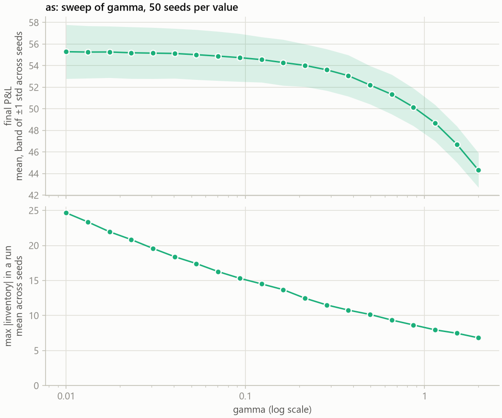
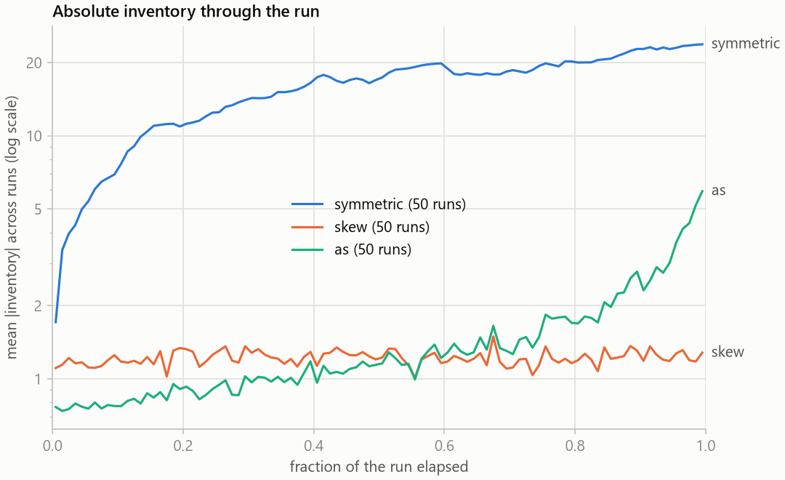

# mm-sim

A small C++17 simulator for comparing market-making strategies on identical simulated markets.

## What it models

A market maker is a trader who stands ready to both buy and sell. It posts a *bid* a little below
the going price and an *ask* a little above it. When one trader sells to the bid and another buys
from the ask, the maker keeps the difference, the *spread*. The catch is that the two sides do not
arrive in balance: after a run of sellers the maker is left holding stock, after a run of buyers it
is short, and until that position is traded away its value moves with the price. Market making is
collecting spread while keeping that *inventory* under control.

mm-sim simulates one market maker in one stock. The price moves at random in one-millisecond steps.
Orders from other traders arrive at random and hit the maker's quotes more often the closer those
quotes sit to the current price. Three quoting rules are run against exactly the same price path and
the same order arrivals, so a difference in outcome comes from the rule and not from luck:

- **symmetric** quotes a fixed distance either side of the price and ignores its inventory;
- **skew** shifts both quotes against its inventory, so the trade that reduces the position becomes
  the more likely one;
- **as** is the Avellaneda-Stoikov (2008) rule, which also shifts against inventory, but by an
  amount that depends on volatility, risk aversion and the time left in the run.

Each run reports its final profit (cash plus inventory valued at the current price), the largest
position it held and the number of fills.

## The model

**Price.** The mid-price `S` is a geometric Brownian motion with no drift, advanced with the exact
log-normal update:

```math
S_{t+\Delta t} = S_t \exp\left(-\tfrac{1}{2}\sigma^2 \Delta t + \sigma \sqrt{\Delta t}\, Z\right), \qquad Z \sim N(0, 1)
```

`σ` is the annualised volatility (`--vol`, default 0.3) and `Δt` is one millisecond in years, with a
year of 252 × 6.5 × 3600 trading seconds. The price starts at 100, and strategies see it rounded to
a tick of 0.01.

**Fills.** On each side, market orders arrive as a Poisson process whose rate falls off
exponentially with the quote's distance `d` from the mid (`mid - bid` or `ask - mid`):

```math
\lambda(d) = A e^{-k d}, \qquad P(\text{fill in one step}) = 1 - e^{-\lambda(d) \Delta t}
```

`A` (`--A`, default 5) is the fill rate per second for a quote at the mid, `k` (`--k`, default 20)
the decay per unit of price, and `Δt` here is 0.001 s. `d` may be negative: a quote pushed through
the mid fills faster than `A` and at a worse-than-mid price, so over-aggressive quoting shows up as
a cost. A fill trades one unit at the quoted price.

**One step.** Every millisecond the maker sees the mid and its inventory and returns a bid and an
ask. Each side fills or not, the trades settle, the position is marked at the mid (P&L is cash plus
inventory times the mid), the row is logged, and only then does the price move. Price and fills use
separate random streams derived from the seed, and one random number is drawn per side per step
whatever the quotes are, so strategies run on the same seed face the same market.

**Strategies.** With `q` the signed inventory, `s` the full spread (`--spread`) and `κ` the skew per
unit of inventory (`--skew`), the two fixed-spread rules quote:

```math
\text{symmetric:} \quad \text{bid}, \text{ask} = S \mp \tfrac{s}{2} \qquad\qquad \text{skew:} \quad \text{bid}, \text{ask} = S - \kappa q \mp \tfrac{s}{2}
```

Avellaneda-Stoikov quotes around a reservation price `r` with spread `δ`, where `γ` is risk aversion
(`--gamma`), `T` the horizon and `t` the time elapsed:

```math
r = S - q \gamma \sigma_a^2 (T - t), \qquad \delta = \gamma \sigma_a^2 (T - t) + \frac{2}{\gamma} \ln\left(1 + \frac{\gamma}{k}\right), \qquad \text{bid}, \text{ask} = r \mp \tfrac{\delta}{2}
```

`σ_a` is the volatility in price units per √second, `σ_a = S_0 σ / √(seconds per year)`, about
0.0124 at the defaults. The default spread of 0.10 equals `2 / k`, which maximises expected spread
income under the fill model and is also the limit of `δ` as `γ → 0`, so with default flags the three
strategies differ only in how they respond to inventory.

## Build and test

You need CMake 3.14 or newer, a C++17 compiler and, for the first configure, Git and network access
to fetch Catch2. The build defaults to Release and treats warnings as errors. On Linux:

```sh
cmake -B build
cmake --build build
ctest --test-dir build
```

Windows: install [WinLibs](https://winlibs.com), which packages GCC, CMake and Ninja together
(`winget install BrechtSanders.WinLibs.POSIX.UCRT`), put its `mingw64\bin` folder on your `PATH`,
and configure with `cmake -B build -G Ninja` instead. The other two commands are the same.

`ctest` runs 57 tests. The binaries are `build/run_sim` and `build/sweep`; on Windows they end in
`.exe`, are linked statically, and `cmd.exe` wants the paths written with backslashes.

## Running

`run_sim` simulates one strategy on one seed, prints its statistics and writes the step log. Flags
are written `--name value`, and `--help` lists them. The defaults are `--strategy symmetric` (or
`skew`, `as`), `--horizon 300` (seconds), `--vol 0.3`, `--spread 0.10` (full width; symmetric and
skew only), `--skew 0.01` (skew only), `--gamma 0.5` (as only), `--k 20`, `--A 5`, `--seed 1` and
`--out path.csv`.

The log has one row per simulated millisecond with columns `time`, `mid`, `bid`, `ask`, `inventory`,
`pnl`, `bid_fill` and `ask_fill`, and every printed statistic can be recomputed from it.

```sh
mkdir results
build/run_sim --strategy symmetric --seed 1 --out results/path_symmetric.csv
build/run_sim --strategy skew --seed 1 --out results/path_skew.csv
build/run_sim --strategy as --seed 1 --out results/path_as.csv
```

`sweep` runs one strategy over a grid of one parameter, on the same seeds at every grid value. It
takes the flags above plus `--param` (any of the numeric ones), `--from`, `--to`, `--steps` (grid
values, default 11), `--seeds` (runs per value, default 50, starting at `--seed`) and the switch
`--log` for a geometrically spaced grid. It writes `--out` (default `sweep.csv`) with one row per
grid value, averaged over seeds, and a second file with `_seeds` added to the name holding one row
per seed per grid value. The last two commands below are one-point sweeps: 50 seeds of a strategy at
its default setting.

```sh
build/sweep --strategy skew --param skew --from 0 --to 0.1 --steps 11 --seeds 50 --out results/sweep_skew.csv
build/sweep --strategy as --param gamma --from 0.01 --to 2.0 --steps 20 --log --seeds 50 --out results/sweep_gamma.csv
build/sweep --strategy symmetric --param spread --from 0.1 --to 0.1 --steps 1 --seeds 50 --out results/baseline_symmetric.csv
build/sweep --strategy as --param gamma --from 0.5 --to 0.5 --steps 1 --seeds 50 --out results/baseline_as.csv
```

`scripts/plot.py` needs Python 3 with matplotlib. `path` draws step logs side by side, `dist` the
final P&L across seeds (`--at` picks one grid value out of a sweep file), `sweep` the averages
against the swept parameter, and `inventory` the mean absolute inventory through the run, given one
directory of step logs per strategy. The loop that writes those logs is bash syntax and fills about
2 GB.

```sh
python scripts/plot.py path results/path_symmetric.csv results/path_skew.csv results/path_as.csv --labels symmetric skew as --out results/paths.png
python scripts/plot.py dist results/baseline_symmetric_seeds.csv results/sweep_skew_seeds.csv results/baseline_as_seeds.csv --at skew=0.01 --out results/pnl_distribution.png
python scripts/plot.py sweep results/sweep_skew.csv --out results/sweep_skew.png
python scripts/plot.py sweep results/sweep_gamma.csv --out results/sweep_gamma.png
for s in symmetric skew as; do mkdir -p results/logs/$s; for i in $(seq 50); do build/run_sim --strategy $s --seed $i --out results/logs/$s/$i.csv; done; done
python scripts/plot.py inventory results/logs/symmetric results/logs/skew results/logs/as --out results/inventory_profile.png
```

## Results

Everything below comes from the commands above, at the default flags unless a parameter is swept.
Sweeps and distributions use seeds 1 to 50, the same 50 markets for every strategy.

One run per strategy on seed 1:



| Strategy | Final P&L | Max \|inventory\| | Fills |
|---|---|---|---|
| symmetric | 56.01 | 30 | 1092 |
| skew | 52.81 | 6 | 1165 |
| as | 51.94 | 7 | 1045 |

Final P&L across 50 seeds:



| Strategy | Mean final P&L | Std across seeds | Mean max \|inventory\| | Mean fills |
|---|---|---|---|---|
| symmetric | 55.29 | 5.38 | 38.52 | 1109.3 |
| skew, skew 0.01 | 52.53 | 1.72 | 5.46 | 1167.3 |
| as, gamma 0.5 | 52.19 | 1.79 | 10.14 | 1057.6 |

Skew sweep for the skew strategy (skew 0 is exactly the symmetric strategy):



| skew | Mean final P&L | Std across seeds | Mean max \|inventory\| | Mean fills |
|---|---|---|---|---|
| 0.00 | 55.29 | 5.38 | 38.52 | 1109.3 |
| 0.01 | 52.53 | 1.72 | 5.46 | 1167.3 |
| 0.02 | 48.98 | 1.49 | 4.14 | 1223.9 |
| 0.03 | 44.94 | 1.36 | 3.34 | 1283.3 |
| 0.04 | 40.57 | 1.21 | 3.02 | 1351.1 |
| 0.05 | 35.56 | 1.05 | 2.86 | 1420.4 |
| 0.06 | 29.83 | 0.87 | 2.30 | 1488.0 |
| 0.07 | 23.52 | 0.66 | 2.02 | 1561.4 |
| 0.08 | 16.46 | 0.44 | 2.00 | 1635.8 |
| 0.09 | 8.65 | 0.27 | 2.00 | 1705.2 |
| 0.10 | 0.12 | 0.15 | 2.00 | 1771.3 |

Gamma sweep for Avellaneda-Stoikov, log-spaced:



| gamma | Mean final P&L | Std across seeds | Mean max \|inventory\| | Mean fills |
|---|---|---|---|---|
| 0.01 | 55.30 | 2.50 | 24.66 | 1107.5 |
| 0.0132 | 55.26 | 2.42 | 23.36 | 1107.5 |
| 0.0175 | 55.27 | 2.39 | 21.96 | 1107.7 |
| 0.0231 | 55.20 | 2.39 | 20.84 | 1106.0 |
| 0.0305 | 55.16 | 2.37 | 19.58 | 1105.4 |
| 0.0403 | 55.13 | 2.31 | 18.40 | 1105.0 |
| 0.0533 | 55.02 | 2.31 | 17.42 | 1103.8 |
| 0.0704 | 54.89 | 2.28 | 16.28 | 1101.7 |
| 0.0931 | 54.75 | 2.22 | 15.32 | 1099.8 |
| 0.123 | 54.56 | 2.10 | 14.52 | 1096.5 |
| 0.163 | 54.29 | 2.13 | 13.70 | 1092.2 |
| 0.215 | 54.03 | 1.97 | 12.48 | 1088.1 |
| 0.284 | 53.62 | 1.93 | 11.52 | 1081.3 |
| 0.375 | 53.08 | 1.91 | 10.78 | 1072.1 |
| 0.496 | 52.21 | 1.77 | 10.16 | 1057.9 |
| 0.656 | 51.35 | 1.84 | 9.36 | 1044.1 |
| 0.866 | 50.17 | 1.74 | 8.66 | 1024.7 |
| 1.15 | 48.70 | 1.68 | 7.96 | 1001.6 |
| 1.51 | 46.73 | 1.68 | 7.48 | 969.1 |
| 2.00 | 44.32 | 1.60 | 6.82 | 929.5 |

Mean absolute inventory through the run, default flags, the same 50 seeds:



### Findings

**Skew trades expected P&L for variance.** Moving from symmetric to a skew of 0.01 lowers the mean
final P&L by 5% (55.29 to 52.53) and its standard deviation across seeds by 68% (5.38 to 1.72),
while the mean largest position falls from 38.5 units to 5.5. The exchange rate then worsens: each
further 0.01 of skew costs between 3.5 and 8.5 of P&L and removes only 0.1 to 0.2 of standard
deviation. Avellaneda-Stoikov shows the same shape: gamma 0.01 leaves the mean where the symmetric
maker has it (55.30) and already halves the standard deviation (2.50), gamma 0.5 gives up 6% of the
mean for a 67% reduction, and gamma 2 gives up 20% for 70%.

**Over-skewing pushes quotes through the mid and destroys P&L.** The half-spread is 0.05, so from a
skew of 0.06 upward a single unit of inventory puts the quote that would reduce the position on the
wrong side of the mid. At a skew of 0.10 a maker that is long one unit asks 0.05 *below* the mid,
giving back on the way out exactly what it earned on the way in. Fills rise by 60% (1109 to 1771)
and mean P&L falls to 0.12.

**Avellaneda-Stoikov's skew fades toward the horizon, so it holds more inventory than a fixed skew
at a matched shift.** Its quote shift per unit of inventory, `γ σ_a² (T - t)`, starts at 0.0458 γ
and falls linearly to zero at the end of the run. Gamma 0.215 starts at 0.0098, practically the
shift of a fixed skew of 0.01, yet its mean largest position is 12.5 units against 5.5. The
inventory profile above shows where that position is taken on. The fixed skew of 0.01 holds a mean
absolute inventory of about 1.2 units for the whole run. Gamma 0.5 starts with more than twice that
shift and holds less, 0.8 units; it crosses the fixed skew 56% of the way through, just where its
shift drops below 0.01, and climbs to 3.7 units over the last tenth of the run and 5.9 at the end.

## Limitations

- **Inventory has no expected cost.** The price is a driftless random walk that takes no notice of
  the maker's fills: there is no adverse selection and no informed flow, so a position adds variance
  to P&L but no expected loss. This is why the symmetric maker has the highest mean above: inventory
  control is pure insurance here.
- **Fills are one unit**, and at most one per side per millisecond.
- **Quote size is on or off.** A strategy can pull a side but cannot choose how much to quote.
- **No latency and no queue position.** Quotes update instantly every millisecond, and a fill
  depends only on distance from the mid, not on other orders resting at the same price.

## Future work

- Adverse selection in the fill model: fills that predict the next price move.
- Size-proportional fills, so that quote size becomes a real decision.
- Replay of real market data in place of the simulated price and order flow.
